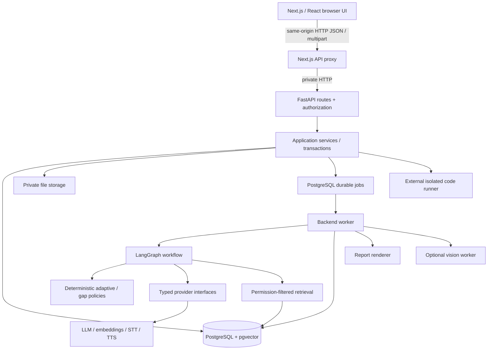
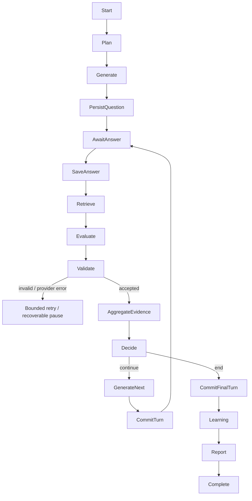

# IntervAI engineering blueprint

Status: full-product blueprint with implementation through Phase 7 learning, practice and focused retry. See [Phase 7 handoff](PHASE7_HANDOFF.md) for actual contracts and evidence policy; later-phase sections remain design targets.

## 1. System architecture

Use a modular monolith, not microservices. One repository, one FastAPI application, one PostgreSQL database, and eventually one worker process sharing the backend package. Add a separately hosted code sandbox only in the coding phase. No Redis, Kafka, Neo4j, or vector database service is needed initially.



Routes validate requests with Pydantic, resolve the authenticated actor, enforce ownership, and invoke services. Services own transactions and domain rules; repositories perform SQLAlchemy queries. Providers never write domain tables directly. The frontend never connects to PostgreSQL or holds provider keys. The Next.js proxy has one fixed backend origin; it is not an arbitrary URL proxy.

Long-running requests create a job and return HTTP 202 plus a job ID. Start with a PostgreSQL job queue using `FOR UPDATE SKIP LOCKED`, leases, bounded retries, and heartbeats. A worker commits progress; the UI polls status. Transactional job insertion prevents losing work on API restart. Delivery is at least once, so every operation must be idempotent. Critical work must not depend on FastAPI in-process background tasks surviving restart.

## 2. Final technology choices

| Layer | Decision | Reason / introduction |
|---|---|---|
| UI | Next.js App Router, React, TypeScript | Pages, server rendering, typed interactive components |
| Styling | Tailwind CSS, shadcn/ui | Design tokens and accessible component foundations |
| Motion / charts | Framer Motion, Recharts | Add when interactive product screens need them; respect reduced motion |
| API | Python 3.12+, FastAPI, Pydantic v2 | Typed contracts and generated OpenAPI |
| Persistence | SQLAlchemy 2 async, psycopg 3, Alembic | Real PostgreSQL transactions; reviewed migrations |
| Database | PostgreSQL 17 + pgvector | Relational evidence and scoped semantic retrieval in one database |
| AI | LangGraph; selective LangChain adapters | Explicit workflow, bounded structured LLM calls; no autonomous swarm |
| Providers | LLM, embedding, STT, TTS interfaces | Configure real model IDs and credentials before each feature is enabled |
| Speech | Turn-based uploads, browser VAD adapter, provider STT/TTS | Reliable recording, transcript review, and retry |
| Vision | OpenCV + suitable licensed detector | Optional worker; choose YOLO only after model/license validation |
| Coding | Monaco editor + remote isolated runner adapter | Candidate code never executes in the API/worker containers |
| PDF | ReportLab | Structured report to PDF without browser-based rendering dependencies |
| DevOps | Docker / Compose, Git, GitHub Actions | Reproducible local stack and CI |
| Tests | pytest, HTTPX, Playwright; Vitest when UI logic arrives | Unit, API, real database, and browser coverage |

Preserve the requested stack. Add only supporting libraries needed by a phase. Lock resolved dependencies; do not install the whole AI/CV stack in Phase 1. Exact model names and provider selections remain configuration decisions, not fabricated integrations. Local disk storage implements the storage interface first; production can use private S3-compatible storage.

## 3. Database specification

See [DATABASE.md](DATABASE.md) for the complete table catalogue, types, constraints, relationships, indexes, and MVP boundaries. Tables are implemented by phase, not all in the foundation. Alembic is the sole schema migration authority; application startup must not call `create_all()`.

## 4. Interview state and concurrency

Lifecycle: `draft → planning → awaiting_answer → processing → awaiting_answer … → finalizing → completed`. `paused`, `cancelled`, and `failed` are explicit states. Resume preserves the outstanding question; it does not generate another one. A failed provider call keeps the saved answer pending and exposes a retry action. Completion is immutable except for a separately versioned re-evaluation/report.

Shared Pydantic state contract (serializable JSON, UUIDs serialized as strings):

```python
class InterviewState(BaseModel):
    schema_version: int
    interview_id: UUID
    candidate_id: UUID
    job_id: UUID | None
    round_id: UUID | None
    revision: int
    status: InterviewStatus
    current_question_id: UUID | None
    question_ids: list[UUID]
    answer_ids: list[UUID]
    current_concept_id: UUID | None
    difficulty: int                 # 1..5
    latest_evaluation_id: UUID | None
    active_misconception_ids: list[UUID]
    active_gap_ids: list[UUID]
    next_action: AdaptiveAction | None
    action_reason_codes: list[str]
    answered_count: int
    max_questions: int
    topic_counts: dict[str, int]
    followup_count: int
    remaining_seconds: int
    plan_version: int
    policy_version: str
    memory_revision: int
    last_committed_operation_id: UUID | None
```

Phase 4 implements the authoritative status/revision contract directly in `interviews`, with bounded recent transcript context and full persisted questions/answers. Durable `interview_jobs` hold leased operations and validated intermediate provider output. The planned `interview_states` snapshot and LangGraph checkpoints remain future extensions; the domain tables are the only source of truth.

An answer submission supplies question ID, expected interview revision, and an idempotency key. Within a short transaction, lock the interview, validate candidate ownership and outstanding question, insert the answer and durable job, increment revision, and mark processing. Release the lock before external calls. The worker uses an operation ID and conditional revision update to commit evaluation, evidence, next action, next question, and state together. Stale workers cannot overwrite a cancellation or newer turn. Unique constraints prevent duplicate evaluations/questions on retries. Checkpoint commits may occur separately: on restart, reconcile against the committed operation ID before continuing.

Example: revision 8 awaiting Q3 → revision 9 answer A3 persisted/processing → retrieve/evaluate/policy outside transaction → revision 10 evaluation E3 + follow-up Q4 + awaiting answer. A refresh returns revision 10 and Q4. If final generation fails, A3 stays saved and no fabricated Q4 is emitted.

## 5. Adaptive policy

The LLM produces a validated rubric result; Python chooses the next action. All thresholds below are initial versioned heuristics to calibrate with expert-labelled answers, not scientific measurements.

Compute 0–100 score from correctness 40%, reasoning 25%, completeness 20%, relevance 15%. Keep clarity separate from technical score. Store each dimension and rubric version. An ungradable/low-evidence answer has no numeric score and does not create gap evidence. Declining to answer is distinct from an outage or bad transcript.

Policy order is deterministic:

1. Cancellation, duration/question limit, or exhausted plan → `END_INTERVIEW`.
2. Invalid transcript, unsupported source, low evaluation confidence → `REQUEST_CLARIFICATION`; do not penalize.
3. Explicit misconception with cited answer span → `ASK_CONCEPT_CHECK` (at most one consecutive check).
4. Score <40 → `DECREASE_DIFFICULTY` and select an available prerequisite; clamp at 1.
5. Score 40–69 or missing required concepts → `ASK_FOLLOW_UP` (maximum two follow-ups per root question).
6. Score ≥85 on two independent questions in the topic → `INCREASE_DIFFICULTY`, or `CHANGE_TOPIC` if topic coverage is complete/difficulty is 5.
7. Otherwise use planned coverage; insert `REVISIT_WEAK_TOPIC` if scheduled and budget allows.
8. Exhausted follow-up budget or repeated question similarity → change concept/topic, never loop indefinitely.

Rules output `{action, target_concept_id, difficulty, reason_codes, evidence_ids, policy_version}`. The generator receives that decision as a constraint and cannot choose its own difficulty/topic. Coverage quotas reserve roughly 60% for job/core topics, 25% for recorded gaps, 15% for exploration, adjusted when categories are absent. Follow-ups count toward the total budget. Question deduplication uses normalized text and semantic similarity within the interview; failure after two regeneration attempts pauses with a recoverable error.

## 6. Workflow responsibilities

These are bounded nodes/functions, not nine independently autonomous agents.

| Responsibility | Inputs / state read | Output / state write | Tools and implementation |
|---|---|---|---|
| Interview planner | Profile, resume/project facts, JD, gaps, budgets | Versioned rounds, coverage, objectives; plan reference | DB reads + structured LLM call, deterministic budget validation |
| Question generator | Plan, action, topic, difficulty, recent questions | Candidate-facing question + hidden rubric and concept tags; question ID | Scoped RAG and structured LLM; validate policy constraints |
| Answer evaluator | Question/rubric, answer, retrieved sources | Dimension scores, evidence spans, missing concepts, uncertainty | Structured LLM provider; schema and source validation |
| Misconception detector | Same evaluation context | Concept-linked claim + quoted answer evidence | Included in evaluator call initially; extra call only when ambiguity justifies it |
| Gap analyzer | Accepted concept evidence and historical aggregates | Gap/misconception lifecycle updates | Deterministic Python + database, no LLM needed |
| Adaptive controller | Evaluation, budget, coverage, gaps | Action, reason codes, next concept/difficulty | Deterministic policy only |
| Learning planner | Gaps, prerequisites, vetted resources | Ordered learning items, exercises, retry scope | Structured LLM draft + validated resource lookup |
| Career advisor | Role requirements, evidence, interests, progress | Explainable role alignment and missing skills | Deterministic match computation + LLM explanation |
| Report generator | Committed interview/evaluation snapshots | Versioned structured report + stored PDF | SQL aggregation + template rendering; optional LLM summary |



Each node has deadlines, retry limits, structured outputs and trace IDs. Use at most two retries with jitter for transient provider failures, one structured-output repair, and per-interview token/cost budgets. Persistent invalid output ends in an explicit failed job. Tools are allowlisted; documents cannot grant tools or override policies.

## 7. RAG pipeline

Ingestion: allowlisted PDF/Markdown/text → isolated extraction with size/time/page limits → Unicode/whitespace cleaning → preserve headings/code and page locators → content hashing/deduplication → concept tagging → chunks → embeddings → publish only approved document versions.

Start with heading-aware chunks around 450 tokens, ~75-token overlap; keep definitions, examples, and code blocks together where possible, with an 800-token hard bound. Store title, version, owner/scope, language, domain, concepts, source URL, license, checksum, page/section, token count and extraction version. Store vectors in `knowledge_embeddings`; dimension is fixed per embedding model/version. Never mix models in an index. A model migration re-embeds into a separate version/table or dimension-specific partition, validates retrieval, then switches an active version.

Retrieve using question + expected concepts + answer claims; filter permissions, approved status, language, domain and active model before ranking. Start with exact cosine search (pgvector `<=>`) and PostgreSQL full-text search; combine ranks with reciprocal-rank fusion, select 6–8 diverse chunks within a ~3,500-token context budget. Add HNSW when measured corpus size/latency warrants it, with recall checks under selective filters. A reranker is optional only after retrieval benchmarks demonstrate value.

Sources travel as immutable chunk IDs and locators. Evaluations link each source through `evaluation_sources` and record which claims it supports. Validate that every cited ID was retrieved and accessible. Retain cited document versions so future edits do not rewrite historical evidence. If retrieval lacks adequate support, mark `insufficient_evidence`, request clarification/review, or grade only explicitly supported concepts; do not label an unsupported claim false. Candidate-uploaded project content supports questions about that project but is not an authoritative technical grading source.

## 8. Persistent memory

Short-term: current round, outstanding question, bounded context, counters and pending action. Long-term: normalized candidate skills, concept observations, gap history, misconceptions, completed learning, goals and interview history. `candidate_memory` stores compact derived statements with links to evidence, confidence, revision, and expiry; it does not replace normalized facts or hold a transcript dump.

After accepted evaluation commits, upsert unique concept evidence and recompute affected aggregates idempotently. Distinguish self-reported skill from assessed proficiency and display evidence coverage. At planning time retrieve current goals, role-relevant skill records, unresolved gaps, recent improvements and a bounded set of supporting observations. The same concept taxonomy powers the relational knowledge graph; prerequisite edges use a cycle-checked adjacency table, so Neo4j is unnecessary. Deletion removes candidate-owned evidence and refreshes derived records; stale memory is never allowed to recreate deleted facts.

## 9. Knowledge-gap algorithm

Every graded concept observation has normalized mastery `m ∈ [0,1]`, evaluator confidence `c`, timestamp, root question, interview, assisted/unassisted flag and rubric/model version. Add explicit incompleteness/misconception flags with answer spans. Exclude invalid audio, disputed/ungradable evaluations, hints and unrelated questions from confirmation evidence.

Reduce correlated follow-ups to one root-question observation; cap each interview's influence at two independent observations per concept. Weight `w = c × exp(-age_days/90)`. Compute weakness index `W = Σ(w × (1-m)) / Σw`; report the evidence count and interview count alongside it. This is an evidence index, not a calibrated probability. Failed follow-ups and repeated misconception occurrences explain why mastery is low; they must not be counted again as independent failures.

Lifecycle rules (initial policy):

- `detected`: one credible weak observation (m <0.6); label provisional, not persistent.
- `confirmed`: at least three independent weak root questions across at least two interviews, aggregate W ≥0.4, and mean evaluator confidence ≥0.7. A repeated misconception must satisfy the same independence requirement.
- `learning`: candidate starts an associated learning item; this does not improve mastery by itself.
- `improving`: at least two new unassisted observations ≥0.7 and recent mastery exceeds the confirmation baseline by ≥0.15.
- `resolved`: three new independent unassisted observations ≥0.8 across at least two later interviews, including one non-identical transfer question, and no recent contradictory misconception.
- Reopen to `detected` on a later weak observation; reconfirm only after the repeated-evidence rule. Insufficient new evidence means stale/needs reassessment, not resolved.

Store every transition and supporting IDs. Practice may guide learning but does not carry the same weight as unassisted assessment. Compare matched concept/difficulty/rubric strata; show sample counts and uncertainty. A single retry can show provisional improvement, while persistent resolution requires more evidence. Score changes are percentage points, not relative percentages unless explicitly labelled.

## 10. API contracts

See [API.md](API.md). REST plus job polling is sufficient for the MVP. WebSockets are deferred until bidirectional streaming is justified; no socket is needed for turn-based audio uploads. SSE can later carry job status, with reconnection and revision IDs.

## 11. Frontend architecture

Next.js layouts: public/auth shell, candidate app shell, interview focus layout, recruiter shell. Server components for initial reads; client components for forms, recording, charts and optimistic non-critical UI. The backend remains the authorization authority. Keep typed API helpers and runtime validation at external boundaries.

| Route | Purpose / major components |
|---|---|
| `/login`, `/register` | Accessible auth form, validation and pending state |
| `/dashboard` | Actual latest result, coverage, next learning task and activity |
| `/profile` | Goals, interests, skills and projects; distinguish assessed/self-reported |
| `/resume` | Upload, extraction status, review/correct extracted facts |
| `/jobs` | JD library, detail and skill match |
| `/interviews` | Filtered history and resumable interviews |
| `/interviews/new` | Mode, JD, topics, duration and device preflight |
| `/interviews/[id]` | Interview room and reconnect/recovery controls |
| `/interviews/[id]/report` | Evidence-backed report and PDF download |
| `/knowledge-gaps` | Provisional/confirmed gaps, evidence and lifecycle |
| `/learning` | Plan, item progress, exercises, focused retry |
| `/progress` | Comparable historical results, sample sizes and coverage |
| `/career` | Role alignment, uncertainty and recommended next steps |
| `/settings` | Theme, devices, privacy, exports and account controls |
| `/recruiter/*` | Authorized jobs, applicants, reports and comparison |

Reusable components: app sidebar/mobile navigation, page header, button/input/dialog, upload dropzone, empty state, error panel, status badge, metric card, source drawer, accessible data table, skill bars, trend chart, roadmap list. Introduce shadcn components as needed rather than copying its entire library. Charts always have a text/table alternative.

Design: restrained ink/teal palette, strong typography, consistent spacing and rounded surfaces. Desktop sidebar collapses to mobile navigation; interview transcript becomes a tab below the interviewer on narrow screens. Support keyboard use, visible focus, screen reader announcements, dark/light tokens and reduced motion. Loading skeletons never resemble actual scores. Empty analytics say no interviews yet; errors preserve form/answer drafts and offer retry. Provider outage is shown distinctly from a candidate performance issue.

## 12. Interview room and request sequence

Header: interview name, authoritative remaining time and progress. Main: avatar/status, current question, topic and optional difficulty (hide difficulty in recruiter assessments if configured). Side/bottom: transcript with candidate/AI turns, source-free question display, recording controls, editable transcript and explicit submit. Optional camera preview; coding mode adds editor/test results. Evaluator rubric and expected answer remain server-only while the interview is active.

Client states: loading → asking/audio playback → ready → recording → transcribing → transcript review → submitting → evaluating → next question; also paused, reconnecting, failed and completed. Text entry works without microphone permissions. Stop recording before AI playback to avoid echo transcription. Prevent duplicate submissions in the UI and enforce idempotency server-side. Poll the interview's revision until a new question or completion arrives. On refresh, fetch the authoritative state; server `started_at`, pause intervals and deadline determine the timer.

## 13. Voice design

TTS interface: `synthesize(text, voice, locale) → audio_asset, duration, provider_metadata`. STT interface: `transcribe(audio_asset, locale) → text, segments, timing_quality`. VAD interface: `detect_segments(pcm, sample_rate) → speech_intervals`. Browser recording uses MediaRecorder with negotiated MIME type; accept bounded webm/ogg/wav inputs and normalize in a constrained worker.

Question text → TTS job → private audio asset → playback. Microphone → local VAD/speech indicators → explicit stop or silence endpoint with maximum duration → upload → STT job → editable transcript → explicit submit → evaluation. Manual recording/stop remains available if VAD fails. Keep the original transcript and candidate-corrected version separately, disclose corrections where appropriate. Audio transcription never silently submits an answer. Audio is optional, with configurable short retention and explicit consent; text answers use the same evaluation path. Speech rate requires reliable word timing and excludes silence; missing timing data produces unavailable metrics, not guesses about personality/confidence.

## 14. Secure coding interviews

The API saves source/language/problem version and creates an execution request. A `CodeRunner` adapter submits to a separately administered sandbox service and polls results. The runner uses per-run ephemeral microVMs or a hardened sandbox runtime with no outbound network, no credentials, non-root user, read-only base filesystem, bounded writable temporary space, CPU/memory/process/output/time quotas, language allowlist and teardown. A plain container sharing the application host is not the intended public hostile-code boundary.

Hidden test definitions never reach the browser. Runner results include exit status, compile/runtime errors, per-test outcomes and resource measurements. Persist these before AI feedback. Derive test pass counts deterministically; complexity commentary is labelled an analysis, not proven Big-O. Signed provider callbacks require replay protection; do not trust client-supplied results. If no secure runner is configured, disable execution with a clear setup state.

## 15. Optional computer vision

With consent, sample low-resolution frames at ~1–2 fps; bounded authenticated uploads feed a separate vision process. OpenCV handles decoding/geometry; a licensed detector estimates person/phone boxes. Head orientation is optional and approximate. Aggregate signals over several frames (e.g. absence >5 seconds, multiple-person signal in three consecutive samples), apply cooldowns, and store start/end time, detector version, confidence, threshold and review state.

The event vocabulary is observational: `person_not_detected`, `multiple_people_detected`, `phone_like_object`, `orientation_change`. Camera disabled/network loss is a separate device event. Do not identify faces, infer emotion/honesty, or subtract technical scores. Retain events rather than frames by default; any evidence image retention requires explicit policy/consent. Reports state these are fallible signals available for review.

## 16. Reports and analytics

Finalization queries committed answers/evaluations/evidence, calculates applicable rubric-weighted scores, counts assessed concepts and missing data, attaches selected sources, gap changes and recommendations, and stores a versioned JSON report snapshot. Do not average ungraded answers as zero. Distinguish answer-weighted interview scores from concept-level mastery. Optional narrative generation cannot change computed numbers and must reference evidence IDs.

Render the same snapshot into a PDF with ReportLab, upload through private storage, record checksum/status, and expose an authorized download. PDF failure leaves the structured report available and can be retried. Comparison uses compatible rubric versions and matched topics/difficulty; otherwise display side-by-side results with a comparability warning. Communication, coding, vision and career sections are omitted or labelled unavailable until actually measured. Basic reports are part of the MVP; advanced analytics follow later.

## 17. Career advisor

Maintain versioned role profiles with required concepts, importance weights and expected levels. Compute evidenced coverage separately from proficiency: unknown skills are unknown, not zero ability. For assessed concepts calculate weighted alignment; expose assessed/required counts and data freshness. Match resume/project claims separately from interview evidence. LLM explains the computed alignment, interests, prerequisite gaps, relevant learning items and possible paths without changing computed values or declaring a universally correct career. Never turn this into an automatic hiring decision.

## 18. Security design

- Auth: Argon2id password hashes; random opaque session token in HttpOnly/SameSite cookie, Secure in production. Store only token hash with expiry/revocation. Rotate on login/privilege change; no browser localStorage JWTs. JWTs are unnecessary for the first-party MVP. Add verified-email/reset-token workflows with hashed short-lived tokens before public deployment.
- Authorization: candidate ownership on every object lookup, organization membership plus explicit candidate application/report grant for recruiters. Admin endpoints require separate role checks and audit logs. A recruiter cannot list all platform candidates.
- CSRF: origin checks and per-session CSRF token on mutations; strict configured CORS for any direct development API access. TLS at deployment ingress; only public frontend/ingress exposed. Health endpoints disclose no DSNs/errors/secrets.
- Uploads: inspect magic bytes, enforce MIME/size/page limits, random storage keys, reject archives/executables, quarantine and scan before parsing. Constrained parser workers, timeouts and resource quotas. Never execute macros or uploaded project files. Project ingestion starts with selected README/text files, not arbitrary repository builds. URL import later must block private/link-local IPs and revalidate redirects to prevent SSRF.
- Prompt injection: all resume/JD/project/RAG text is untrusted quoted data. No document can alter system policy, request secrets, enable tools or set scores. Use structured schemas, tool allowlists, source ownership filters and server-side output validation. Detecting suspicious strings alone is insufficient. Generated Markdown is sanitized; no arbitrary HTML/script rendering.
- Privacy: minimize provider payloads, avoid sending unnecessary identity fields, provide retention/export/deletion, private storage, short-lived signed downloads, consent for media. Logs contain IDs/timing/error categories rather than resume/answer bodies. Memory, vectors and derived reports participate in deletion; backup retention is documented.
- DB: parameterized SQL, least-privilege runtime account, separate migration credentials, TLS for remote connections, bounded connection pools, transaction deadlines and tested backups. Tenant filters are mandatory; consider RLS as defense in depth when organizations arrive.
- Secrets: ignored environment files locally, deployment secret manager later; never NEXT_PUBLIC provider credentials, image-layer secrets or token logs. Rotate compromised credentials. Compose defaults are local-only.
- Rate limits: ingress limits on auth/uploads; per-user concurrent interview/job limits and token budgets in the database. DB-backed counters/locks work across workers. Redis is optional only after measured need.
- Code isolation follows section 14; sandbox has no DB credentials or Docker socket. Vision events do not authorize punitive automated actions.

## 19. Target folder layout

```text
frontend/
  src/app/                    # route groups, pages, loading/error boundaries
  src/components/{ui,layout,interview,charts}/
  src/features/{profile,interviews,learning,reports}/
  src/lib/                    # typed API, formatting, shared validation
backend/
  app/main.py
  app/api/{routes,dependencies}/
  app/core/                   # settings, auth, logging
  app/db/                     # engine/session and model metadata
  app/models/                 # normalized SQLAlchemy tables by domain
  app/schemas/                # Pydantic input/output/state contracts
  app/services/               # use cases and transaction boundaries
  app/repositories/           # permission-scoped queries
  app/ai/{graphs,nodes,prompts,policies}/
  app/providers/              # LLM, embeddings, speech, storage, code adapters
  app/rag/                    # ingestion and scoped retrieval
  app/workers/                # leased durable jobs
  migrations/                 # Alembic revisions
knowledge_base/{sources,manifests}/
tests/{backend,integration,e2e,ai_fixtures}/
docker/                       # Dockerfiles and DB bootstrap SQL
scripts/                      # setup/check/ingestion utilities
docs/                         # architecture, API, DB and verification
```

Create directories when their phase needs them; the tree is the final design, not a request for empty placeholder implementations.

## 20. Environment design

Root `.env.example` documents database connection, internal API URL, auth settings, local storage and future provider keys/model IDs. Browser-visible configuration contains no credentials. Docker gets a container-host database URL; native development uses localhost and the published database port. Validate active configuration at startup. Future feature startup fails clearly if enabled without its provider credentials; Phase 1 requires no paid AI accounts.

## 21. Implementation roadmap and gates

| Phase | Deliverable | Gate before proceeding |
|---|---|---|
| 1 Foundation | Frontend, API, PG/pgvector, Compose, environment, health checks | Production UI build, API tests, real DB readiness, Compose startup verified |
| 2 Identity | Registration/session auth/profile + initial migrations | Ownership/isolation, CSRF and password tests |
| 3 Documents | Resume/JD upload/extraction + candidate review | Real extraction persisted; malicious/invalid uploads rejected |
| 4 Interview | Durable jobs, plan/question/answer persistence, real LLM | Text interview completes and reload recovers state |
| 5 Adaptation | Typed evaluations, deterministic next-action policy | Branches, duplicate submission and outage recovery tests |
| 6 RAG | Approved small technical corpus and source-linked grading | Retrieval benchmarks and insufficient-evidence handling |
| 7 Memory/gaps | Concept evidence, longitudinal rules and transitions | Single bad answer never confirms persistent gap |
| 8 Learning/retry + basic reports | Learning plan, focused retry, JSON/PDF and comparison | Full MVP journey with real data and two sessions |
| 9 Voice | Turn-based STT/TTS/VAD + transcript review | Permissions/outage/text fallback and audio cleanup |
| 10 Coding | Secure remote runner + actual test cases | Isolation, resource limits and tampered result tests |
| 11 Project depth | Project-context interview mode | Questions traceable to candidate project facts |
| 12 Vision | Opt-in signal pipeline | False-positive review, consent and retention checks |
| 13 Career | Versioned role requirements and explained alignment | Evidence coverage, no invented competency |
| 14 Advanced reports/analytics | Communication and comparable longitudinal analytics | Aggregation/denominator and PDF checks |
| 15 Recruiter | Organizations, jobs, applications and scoped reports | Cross-tenant authorization matrix |
| 16 Release hardening | Load, restore drill, observability and deployment | End-to-end acceptance and security checklist |

Security, tests and basic reporting begin early, not only in Phase 16. Indicative solo-student scope is several months rather than a weekend; estimate each phase after its dependencies are verified. Do not promise dates before provider access and development capacity are known.

## 22. MVP acceptance

One candidate can register, review extracted resume facts, select a JD/target role, take a real text interview with adaptive follow-ups and source-grounded evaluation, reload/resume, receive a persisted report and provisional learning gap, start learning, retry the same concept at comparable difficulty, and view evidence-backed change. Confirmed persistent gaps and resolution require the repeated evidence thresholds. No voice, avatar animation, vision, coding or recruiter UI is required to prove this loop. The first report includes a real PDF; every score comes from accepted stored evaluations.

## 23. Testing strategy

- Unit: adaptation boundaries, difficulty clamps, gap transitions, weighting/decay, rubric scoring, deadlines and role matching. Use frozen clocks and fixed IDs.
- DB/integration: real PostgreSQL with pgvector, migrations up/down in disposable databases, FK/check constraints, scoped vector retrieval, transaction rollback, unique idempotency and concurrent submit races. SQLite is not a substitute.
- API: auth/ownership matrix, validation, pagination, error envelope, polling, cancellation, upload limits and signed-download permissions.
- AI services: inject deterministic provider fixtures for CI orchestration tests; explicitly label fixtures as test-only. Schema-invalid outputs, invented citations, prompt injection, rate limits and timeouts must be exercised. No fixture provider in the production registry.
- Live AI evaluation: opt-in, budget-capped benchmark suite with expert-labelled questions/answers; measure rubric agreement, citation validity, retrieval recall@k and policy stability rather than exact prose. Record provider/model/prompt/rubric versions; compare against baselines before changing models.
- Frontend: accessible forms, draft preservation, room state transitions, recording permissions, unavailable states and keyboard navigation.
- E2E: real database and deterministic test provider for repeatable CI; separate explicitly configured live-provider smoke journey. Register → resume → interview → report → learning → retry → compare. Reload during a turn; worker crash after provider call; submit the same answer twice.
- Reports: recompute numbers from fixtures, assert no ungraded-as-zero errors, verify PDF content/page layout in the report phase. Production fixtures never seed fake candidate analytics.

## 24. Historical Phase 1 boundary

This section recorded the original Phase 1 stop condition. Phases 1–3 are now implemented and verified. Interview agents, questions and scoring remain outside the current boundary; see the Phase 3 handoff.

## Official implementation references

- [Next.js installation](https://nextjs.org/docs/app/getting-started/installation): App Router setup and runtime prerequisites.
- [FastAPI containers](https://fastapi.tiangolo.com/deployment/docker/): application image guidance.
- [SQLAlchemy asyncio](https://docs.sqlalchemy.org/en/20/orm/extensions/asyncio.html): async engine/session lifecycle.
- [pgvector](https://github.com/pgvector/pgvector): vector operators, indexes and model/dimension considerations.
- [LangGraph checkpoint reference](https://reference.langchain.com/python/langgraph/checkpoints): durable workflow checkpoints, distinct from domain memory.
- [Compose startup ordering](https://docs.docker.com/compose/how-tos/startup-order/): health-gated dependencies.

## Implemented Phase 6 memory boundary

The implementation now extends through Phase 6 candidate memory and knowledge gaps. See [Phase 6 handoff](PHASE6_HANDOFF.md) for the actual evidence policy and thresholds; earlier full-product sections remain blueprint targets. CandidateMemoryService updates indexed aggregates from immutable Phase 5 evaluation/source evidence inside the interview commit. Candidate row locks serialize updates, uniqueness makes retries idempotent, and database triggers prevent historical edits. Simulation publication waits for completion. Future plans receive bounded, relevant confirmed/improving evidence and respect explicit topics/current job scope. Learning, retry-learning, voice, vision, sandbox and career advice remain future phases.


## Implemented Phase 7 learning boundary

Phase 7 adds candidate-owned persisted roadmaps/targets/items/actions/attempts/replay keys around the Phase 1–6 services. Priority and curriculum ordering are deterministic; optional typed content generation retrieves from the existing technical corpus. Practice reuses the interview evaluator but earns no independent mastery evidence. Retry uses the existing planner/adaptive worker with application-enforced target scope, no hints, prior-question context and exact-repeat rejection. Completion atomically updates memory and writes an immutable comparison from actual supported evaluations. Explicit learning actions are separately audited. Plans are reused on reads; only explicit regeneration creates an updated snapshot. See [Phase 7 handoff](PHASE7_HANDOFF.md) for thresholds and limits. Later media/career/recruiter sections remain blueprint targets.

## Implemented Phase 8 voice layer

Voice is a turn-based interface around the existing interview service. Browser AudioWorklet PCM → bounded temporary WAV → existing leased PostgreSQL interview_jobs STT operation → persisted original transcript → explicit reviewed AnswerInput → existing RAG/evaluation/adaptive/memory/learning pipeline. Existing LLMProvider now includes Gemini and OpenAI selected by configuration, with no silent failover; embeddings remain separate. Independent STT/TTS interfaces implement Vosk/eSpeak locally and OpenAI cloud adapters, with injected fixtures confined to tests. Question audio reads the persisted LLM question, including optional concise LLM-generated transitions, and uses the same worker.

A persisted session revision/state coordinates capture, transcription and playback. Authenticated owner/state/revision checks protect speech operations before and after slow calls; failures leave typed answering available. Temporary candidate audio is discarded after processing; TTS/orphans expire through worker cleanup. Metrics are actual PCM/transcript communication measurements and never enter scoring. See [Phase 8 handoff](PHASE8_HANDOFF.md) for exact state, privacy, provider and browser contracts.


## Implemented Phase 9 coding boundary

Coding extends the existing interview engine and PostgreSQL leased queue. Structured validated problems and immutable-source submissions link existing candidates, questions, answers, and jobs. The worker sends HTTP execution requests to a dedicated non-root Docker service; it never launches candidate code. Each compiler/runtime enters fresh rootless user/PID/network/mount namespaces, drops capabilities, and receives irreversible Landlock/seccomp restrictions and resource/output limits. The service has no Docker socket, host directory mounts, published port, or host execution fallback. Temporary job storage is cleaned on completion/cancellation.

Public Run exposes bounded public diagnostics. Final Submit persists aggregate public+hidden outcomes and creates an existing answer evaluation job. Application code enforces measured test-pass correctness before the existing adaptive decision and memory update; typed LLM complexity/code review remains explicitly estimated. Coding evidence uses existing gap/learning policies, and learning retries from coding baselines select fresh validated coding problems. Gemini/OpenAI, embeddings/pgvector, and speech abstractions remain unchanged. The outer Docker service is reused; per-execution ephemeral isolation is provided by rootless kernel namespaces rather than Docker-control access. The shared-kernel security assumptions, exact controls, tests, and limits are in [Phase 9 handoff](PHASE9_HANDOFF.md).


## Current LLM selection after Phase 9 specification update

OpenAI is primary (`LLM_PROVIDER=openai`, `LLM_MODEL=gpt-6-luna`), using the existing Responses structured-output adapter. Gemini remains available through its existing generateContent adapter. Vendor-specific models take precedence over `LLM_MODEL`; OpenAI accepts `OPENAI_API_KEY` or legacy `LLM_API_KEY`, and Gemini requires `GEMINI_API_KEY`. Compose forwards both supported OpenAI key settings to server-side API/worker only. There is no automatic provider fallback. Embeddings, pgvector, STT, and TTS remain independent. Credentials are supplied locally at final integration; a missing OpenAI key produces the existing configuration error. Earlier phase descriptions record their historical development defaults. See [current handoff](PHASE9_HANDOFF.md) and [separate live Gemini smoke](GEMINI_SMOKE.md).


## Implemented Phase 10 visual boundary

Optional browser video-only capture samples JPEG images at a configurable cadence. The authenticated same-origin API bounds/validates each image and performs actual local SSD MobileNet V2 COCO inference through OpenCV, outside database locks. Browser and API admission gates drop extra frames instead of queuing them. Persisted session revisions, sequence numbers, and expiring claims reject stale work; the existing worker closes abandoned/inactive sessions without ever storing or processing frame payloads.

Temporal aggregation confirms person presence/absence, multiple persons, and phones before creating consolidated integrity episodes. Client camera/device notices are separately marked unverified. Only event metadata and observed timestamps/durations/model scores are retained; candidate images/video/boxes are discarded. Events do not enter scoring, adaptive decisions, RAG, candidate memory, gaps, or learning. Person presence is not identity verification. Head pose and psychological/intent inference are not implemented. Default configuration is disabled; an enabled deployment still requires an explicit camera click/permission. Per-interview `vision_enabled` and `vision_phone_enabled` control optional availability and phone event generation. See [Phase 10 handoff](PHASE10_HANDOFF.md) for limits, licensing/provenance, retention, actual fixtures, and physical-camera pending verification.


## Implemented Phase 11 career guidance

Career analysis reuses candidate profile/goals, parsed resume claims, experience and education, independent interview memory/evidence, confirmed knowledge gaps, learning-plan/retry history, and completed coding measurements. It excludes Phase 10 integrity observations, Phase 8 acoustic metrics, contacts, source code, and raw transcripts. Candidate-owned job requirements are snapshotted separately from the curated illustrative role taxonomy. The taxonomy is a manageable seeded set, versioned with provenance; it is not universal labor-market truth.

The deterministic readiness policy matches canonical skill names/aliases, filters to recent independent grounded unassisted evidence, and reports DEMONSTRATED, DEVELOPING, LIMITED_EVIDENCE, or NOT_DEMONSTRATED with counts, recency, trend when sample thresholds suffice, explanation, and source identifiers. Resume/experience claims are labeled self-reported and cannot prove proficiency. Role cards show these facts and trade-offs without an opaque total score or role ranking. Each explicit analysis stores an immutable evidence snapshot and version; idempotency keys deduplicate requests and a documented seven-day/evidence-change policy marks stale analyses without generating content during reads.

Career profile edits reuse candidate goals and are revision-checked. Candidate roadmap choices are stored per historical analysis. Existing confirmed gaps feed the Phase 7 learning-plan service; a suggested step without a confirmed gap asks the candidate to collect evidence rather than fabricating a learning gap. Optional advisor explanations use the existing `LLMProvider`; bounded relevant summaries and existing pgvector RAG sources are passed through strict structured-output/source validation. Provider failure leaves deterministic readiness available. See [Phase 11 handoff](PHASE11_HANDOFF.md) for APIs, persistence, tests, security, verified flows, provider limitations, and startup.

## Implemented Phase 12 reporting and final integration

Completed interview evidence can be captured in immutable, fingerprinted report versions and downloaded as PDFs rendered from the saved snapshot. Reports use existing persisted evaluation, source, decision, code-result aggregate, voice measurement, visual-event, knowledge-gap, learning, and career evidence. They omit secrets, contact details beyond the candidate-owned report header, code, hidden coding cases, and raw media. Candidate analytics query persisted records only and report insufficient data explicitly. Recruiter access begins only after explicit application consent and is constrained to the recruiter-owned posting, the candidate's exact analyzed job copy, related resume/match evidence, and completed linked interviews. Candidate withdrawals remove applications from active recruiter views. Administrator readiness reveals provider identifiers and status only; role changes have append-only audit entries. Worker health is recorded in PostgreSQL for cross-container visibility. See [Phase 12 handoff](PHASE12_HANDOFF.md) and [final integration](FINAL_INTEGRATION.md) for operator workflow and remaining provider/device gates.
