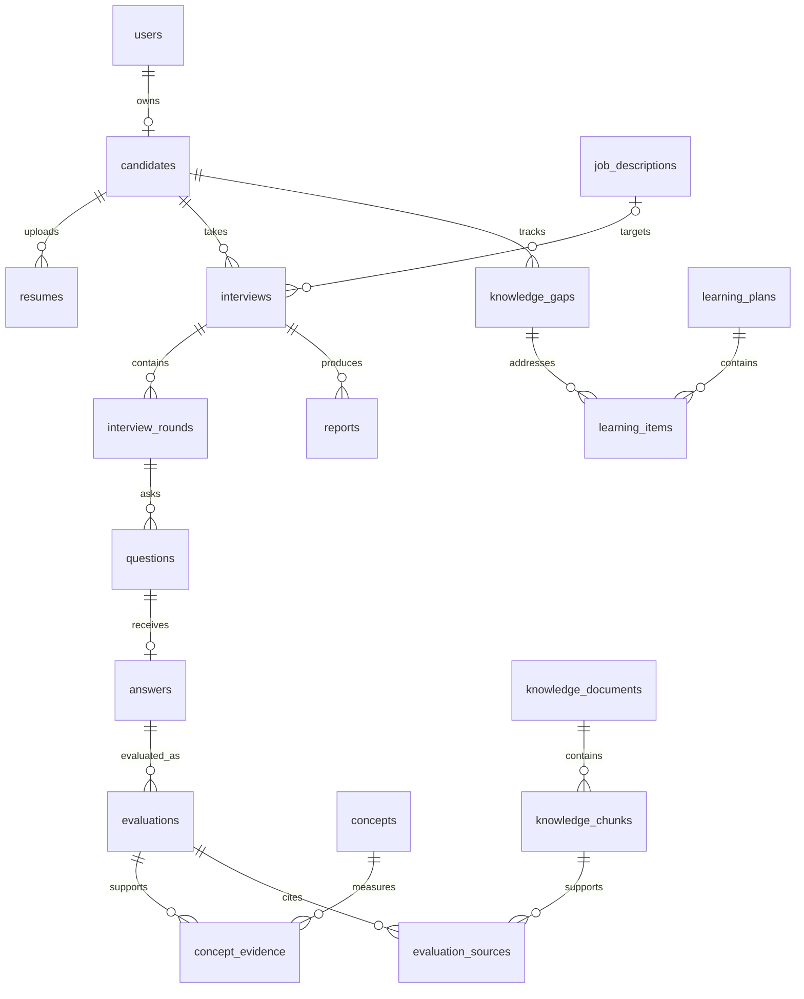

# PostgreSQL schema design

This is the full-product target schema. M = required by the Phase 8 MVP; L = later. Phases 1–10 now implement identity/profile, resume/job intelligence, adaptive interviews, RAG evidence, memory/gaps, learning/retries, speech, coding, and optional visual observations. See [Phase 6 handoff](PHASE6_HANDOFF.md) and the implemented-schema section at the end for actual fields and deliberate differences from blueprint targets. The implemented-schema sections below supersede blueprint targets; remaining career/reporting tables are planned.

## Conventions and integrity

Unless a table declares a composite primary key, every table has `id uuid PRIMARY KEY` (server-generated UUID), `created_at timestamptz NOT NULL DEFAULT now()`. Mutable tables also have `updated_at timestamptz NOT NULL`. All listed fields are NOT NULL unless suffixed `?`. `FK table` means a foreign key to `table.id`; all FK columns receive B-tree indexes unless already a leading column of a listed index. `U(...)` means a unique constraint/index. `I(...)` means an additional B-tree index. State strings are `varchar(32)` with CHECK constraints listing allowed states from the domain; scores have range checks, never free-form LLM text. JSONB is for versioned snapshots/structured metadata, not relationships. Arrays are used only for bounded primitive configuration, never lists of entity IDs that require referential integrity.

Timestamps are UTC. Passwords and session tokens are never stored raw. Owner deletion is an explicit transactional erase workflow; candidate aggregates/evidence cascade, shared technical knowledge uses RESTRICT, and nullable historical external references use SET NULL where appropriate. Referenced evaluation/document versions remain immutable until an authorized erasure workflow. Sensitive audit records have a separate retention policy. Monetary/token counts are nonnegative integers; duration is milliseconds unless named otherwise.

The service validates cross-owner relationships, and composite FKs enforce critical boundaries: interviews expose U(id,candidate_id); rounds expose U(id,interview_id); questions expose U(id,interview_id); answers expose U(id,interview_id). A question's (round_id,interview_id) references its round, an answer's (question_id,interview_id) references its question, and evaluation's (answer_id,interview_id) references its answer. Candidate evidence includes candidate_id and interview_id with composite interview ownership FK. FK indexes support ownership filters; no global unscoped candidate queries.

## Identity and profile

| Table | Fields beyond conventions | Constraints / indexes / relationships | Stage |
|---|---|---|---|
| users | email varchar(320), password_hash text, display_name varchar(120), role varchar(20), disabled_at timestamptz?, email_verified_at timestamptz? | U(lower(email)); role candidate/recruiter/admin; one user → optional candidate; email normalized | M |
| sessions | user_id uuid FK users, token_hash bytea, csrf_hash bytea, expires_at timestamptz, revoked_at timestamptz?, last_seen_at timestamptz | U(token_hash); I(expires_at); many sessions/user; expiry > creation | M |
| auth_tokens | user_id uuid FK users, kind varchar(20), token_hash bytea, expires_at timestamptz, used_at timestamptz? | U(token_hash); kind verify_email/reset_password; I(expires_at); one-use | L before public release |
| candidates | user_id uuid FK users, headline varchar(200)?, biography text?, timezone varchar(64), experience_months int, memory_revision bigint | U(user_id); experience and revision ≥0; 1:1 user | M |
| candidate_goals | candidate_id uuid FK candidates, role_title varchar(120), interest text?, priority smallint, active bool | U(candidate_id,role_title); priority ≥0; many goals/candidate | M |
| files | owner_user_id uuid FK users, storage_key text, original_name text, mime_type varchar(100), size_bytes bigint, sha256 char(64), scan_status varchar(20), expires_at timestamptz? | U(storage_key); size >0; pending/clean/rejected; I(owner_user_id,created_at) | M |
| resumes | candidate_id uuid FK candidates, file_id uuid FK files, version int, status varchar(20), extracted_text text?, parsed_facts jsonb?, parser_version text?, reviewed_at timestamptz? | U(candidate_id,version); U(file_id); queued/processing/review/ready/failed; version >0 | M |
| skills | slug varchar(100), name varchar(120), description text? | U(slug); canonical vocabulary | M |
| concepts | skill_id uuid FK skills, parent_id uuid? FK concepts, slug varchar(120), name text, description text? | U(skill_id,slug); CHECK parent_id != id; taxonomy cycle check in service | M |
| concept_prerequisites | concept_id uuid FK concepts, prerequisite_id uuid FK concepts | Composite PK(concept_id,prerequisite_id); not self; reverse index(prerequisite_id); service rejects graph cycles | M |
| candidate_skills | candidate_id uuid FK candidates, skill_id uuid FK skills, self_reported_level smallint?, assessed_mastery numeric(5,4)?, evidence_count int, assessed_at timestamptz? | U(candidate_id,skill_id); self level 1..5; mastery 0..1; count ≥0; derived score with evidence | M |
| projects | candidate_id uuid FK candidates, title varchar(160), description text, repository_url text?, documentation_file_id uuid? FK files, extracted_context text?, status varchar(20) | I(candidate_id,created_at); draft/processing/ready/failed; repository URL does not imply permission to execute/fetch | M basic; deeper ingestion L |
| project_skills | project_id uuid FK projects, skill_id uuid FK skills | Composite PK(project_id,skill_id); reverse skill index | M |
| job_descriptions | owner_user_id uuid FK users, organization_id uuid? FK organizations (added later), title varchar(160), description text, parsed_requirements jsonb?, status varchar(20), version int | I(owner_user_id,created_at); draft/processing/ready/archived/failed; version >0 | M |
| job_skills | job_id uuid FK job_descriptions, skill_id uuid FK skills, importance numeric(5,4), target_level smallint | Composite PK(job_id,skill_id); importance 0..1; target 1..5; reverse skill index | M |

## Interviews and evidence

Phase 4 implements `interviews`, `interview_plans`, `interview_rounds`, `interview_questions`, `interview_answers`, `answer_evaluations`, `adaptive_decisions`, and `interview_jobs`. The broader tables below remain the long-term design where explicitly marked for later phases. Migration `1acbf47bc035` is the exact Phase 4 source of truth.

| Table | Fields | Constraints / indexes / relationships | Stage |
|---|---|---|---|
| interviews | candidate_id uuid FK candidates, job_id uuid? FK job_descriptions, resume_id uuid? FK resumes, retry_of_id uuid? FK interviews, kind varchar(20), status varchar(32), revision bigint, plan_version int, policy_version text, max_questions int, duration_seconds int, started_at timestamptz?, ended_at timestamptz?, paused_at timestamptz?, paused_seconds int, deadline_at timestamptz? | I(candidate_id,created_at DESC), I(status); revision ≥0; max_questions 1..50; duration 60..7200; end ≥ start; technical/project/coding/mixed/retry; lifecycle in architecture | M |
| interview_rounds | interview_id uuid FK interviews, ordinal int, kind varchar(20), title text, budget_questions int, status varchar(20) | U(interview_id,ordinal); ordinal,budget >0; pending/active/completed/skipped | M |
| interview_topics | round_id uuid FK interview_rounds, concept_id uuid FK concepts, target_difficulty smallint, question_budget int, ordinal int | U(round_id,concept_id); U(round_id,ordinal); difficulty 1..5; budget >0 | M |
| interview_projects | interview_id uuid FK interviews, project_id uuid FK projects | Composite PK(interview_id,project_id); service enforces same candidate | L |
| questions | interview_id uuid FK interviews, round_id uuid FK interview_rounds, parent_question_id uuid? FK questions, sequence int, text text, difficulty smallint, hidden_rubric jsonb, generator_run_id uuid? FK ai_runs, operation_id uuid | U(interview_id,sequence); U(operation_id); sequence >0; difficulty 1..5; parent must be same interview via composite FK; immutable once shown | M |
| question_concepts | question_id uuid FK questions, concept_id uuid FK concepts, weight numeric(5,4) | Composite PK(question_id,concept_id); weight >0 and ≤1; service validates sum=1 | M |
| answers | interview_id uuid FK interviews, question_id uuid FK questions, text text, original_transcript text?, source varchar(12), audio_file_id uuid? FK files, response_ms int?, submitted_at timestamptz, idempotency_key uuid, payload_hash char(64) | U(question_id); U(interview_id,idempotency_key); text/voice/code; duration ≥0; duplicate key with different payload → conflict | M text; audio L |
| evaluations | interview_id uuid FK interviews, answer_id uuid FK answers, version int, status varchar(24), overall_score numeric(5,2)?, evaluator_confidence numeric(5,4), rationale text, rubric_version text, ai_run_id uuid FK ai_runs, operation_id uuid, supersedes_id uuid? FK evaluations | U(answer_id,version); U(operation_id); accepted/insufficient_evidence/disputed; score 0..100; confidence 0..1; accepted score required; immutable versions | M |
| evaluation_dimensions | evaluation_id uuid FK evaluations, dimension varchar(32), score numeric(5,2), weight numeric(5,4), explanation text | Composite PK(evaluation_id,dimension); score 0..100, weight 0..1; dimension allowlist; weighted calculation validated by service | M |
| concept_evidence | candidate_id uuid FK candidates, interview_id uuid FK interviews, evaluation_id uuid FK evaluations, concept_id uuid FK concepts, root_question_id uuid FK questions, mastery numeric(5,4), confidence numeric(5,4), incomplete bool, failed_followup bool, assisted bool, observed_at timestamptz, answer_span text? | U(evaluation_id,concept_id); I(candidate_id,concept_id,observed_at DESC); values 0..1; composite ownership/evaluation interview FKs | M |
| interview_states | interview_id uuid PK/FK interviews, revision bigint, schema_version int, snapshot jsonb, last_operation_id uuid? | Single current snapshot/interview; version >0, revision ≥0; schema validated by Pydantic; snapshot references checked within transaction | M |
| interview_events | interview_id uuid FK interviews, sequence bigint, kind varchar(40), payload jsonb, operation_id uuid | U(interview_id,sequence); U(interview_id,operation_id,kind); append-only status/action history | M |
| ai_runs | candidate_id uuid? FK candidates, interview_id uuid? FK interviews, purpose varchar(40), provider text, model text, prompt_version text, schema_version text, status varchar(20), input_tokens int?, output_tokens int?, latency_ms int?, error_code text?, trace_id uuid | I(interview_id,created_at); pending/succeeded/failed; no raw sensitive prompts in default logs | M |
| jobs | kind varchar(40), owner_user_id uuid? FK users, interview_id uuid? FK interviews, payload jsonb, status varchar(20), dedupe_key text, attempts int, max_attempts int, available_at timestamptz, lease_until timestamptz?, worker_id text?, result jsonb?, error_code text? | U(dedupe_key); partial I(available_at) WHERE status='queued'; I(lease_until) WHERE status='running'; queued/running/succeeded/failed/cancelled; attempts ≥0 | M |

An evaluation re-grade supersedes a prior version; gap computation selects the latest accepted non-disputed evaluation per answer, never all versions. Domain commits and evidence updates use one operation ID and transaction. `ai_runs` represent attempts; failed attempts do not create mastery evidence.

## Knowledge, memory and learning

| Table | Fields | Constraints / indexes / relationships | Stage |
|---|---|---|---|
| knowledge_documents | owner_user_id uuid? FK users, project_id uuid? FK projects, title text, scope varchar(20), source_uri text?, license text?, version int, sha256 char(64), status varchar(20), extraction_version text, language varchar(16), approved_by uuid? FK users, content_file_id uuid FK files | U(content_file_id,version); I(scope,status); technical/project scope; quarantined/processing/review/approved/retired/failed; project requires owner/project; technical approval requires reviewer | M |
| knowledge_chunks | document_id uuid FK knowledge_documents, ordinal int, content text, token_count int, page_start int?, page_end int?, section_path text?, content_hash char(64), search_vector tsvector | U(document_id,ordinal); GIN(search_vector); token_count >0; content immutable once referenced | M |
| chunk_concepts | chunk_id uuid FK knowledge_chunks, concept_id uuid FK concepts | Composite PK(chunk_id,concept_id); reverse concept index | M |
| embedding_models | provider text, model text, dimensions int, version text, active bool | U(provider,model,version); dimensions >0; one active model enforced by partial unique index on active WHERE active | M |
| knowledge_embeddings | chunk_id uuid FK knowledge_chunks, model_id uuid FK embedding_models, embedding vector(1536) | Composite PK(chunk_id,model_id); 1536 is initial deployment contract, configurable only through migration/model choice; HNSW vector_cosine_ops when needed; dimension/model compatibility validated on ingestion | M |
| evaluation_sources | evaluation_id uuid FK evaluations, chunk_id uuid FK knowledge_chunks, retrieval_rank int, similarity numeric(6,5)?, supported_claim text | Composite PK(evaluation_id,chunk_id); reverse chunk index; rank >0; similarity -1..1; retain cited source version | M |
| candidate_memory | candidate_id uuid FK candidates, concept_id uuid? FK concepts, kind varchar(24), memory_key text, summary text, confidence numeric(5,4), revision bigint, expires_at timestamptz? | U(candidate_id,memory_key); I(candidate_id,kind); confidence 0..1; strength/weakness/preference/context; derived summaries only | M |
| memory_evidence | memory_id uuid FK candidate_memory, evidence_id uuid FK concept_evidence | Composite PK(memory_id,evidence_id); reverse evidence index; service validates candidate ownership | M |
| knowledge_gaps | candidate_id uuid FK candidates, concept_id uuid FK concepts, status varchar(20), weakness_index numeric(5,4), evidence_count int, interview_count int, baseline_mastery numeric(5,4)?, detected_at timestamptz, confirmed_at timestamptz?, resolved_at timestamptz?, last_observed_at timestamptz, policy_version text | U(candidate_id,concept_id); I(candidate_id,status); index/mastery 0..1; detected/confirmed/learning/improving/resolved | M |
| gap_evidence | gap_id uuid FK knowledge_gaps, evidence_id uuid FK concept_evidence | Composite PK(gap_id,evidence_id); reverse evidence index; no repeated observation counting | M |
| gap_transitions | gap_id uuid FK knowledge_gaps, from_status varchar(20)?, to_status varchar(20), reason text, policy_version text, operation_id uuid | U(gap_id,operation_id); I(gap_id,created_at); append-only | M |
| gap_transition_evidence | transition_id uuid FK gap_transitions, evidence_id uuid FK concept_evidence | Composite PK(transition_id,evidence_id); preserves transition justification | M |
| misconceptions | candidate_id uuid FK candidates, concept_id uuid FK concepts, canonical_key text, claim text, correction text, status varchar(20), first_seen_at timestamptz, last_seen_at timestamptz | U(candidate_id,concept_id,canonical_key); I(candidate_id,status); detected/confirmed/resolved; paraphrases normalized and reviewed | M |
| misconception_evidence | misconception_id uuid FK misconceptions, evidence_id uuid FK concept_evidence, answer_quote text | Composite PK(misconception_id,evidence_id); nonempty exact answer span | M |
| learning_plans | candidate_id uuid FK candidates, source_interview_id uuid? FK interviews, version int, status varchar(20), title text, planner_run_id uuid? FK ai_runs | I(candidate_id,created_at); draft/active/completed/archived; version >0 | M |
| learning_resources | concept_id uuid FK concepts, title text, url text, kind varchar(20), reviewed_at timestamptz, approved_by uuid FK users | U(url,concept_id); article/video/exercise/document; curated resource catalogue | M |
| learning_items | plan_id uuid FK learning_plans, gap_id uuid? FK knowledge_gaps, concept_id uuid FK concepts, resource_id uuid? FK learning_resources, ordinal int, title text, instructions text, kind varchar(20), status varchar(20), completed_at timestamptz? | U(plan_id,ordinal); ordinal >0; read/practice/retry; pending/in_progress/completed; completion does not imply mastery | M |
| practice_questions | learning_item_id uuid FK learning_items, text text, difficulty smallint, expected_rubric jsonb | I(learning_item_id); difficulty 1..5; practice distinguished from assessment | M |
| retry_targets | interview_id uuid FK interviews, gap_id uuid FK knowledge_gaps, baseline_interview_id uuid FK interviews, target_difficulty smallint | Composite PK(interview_id,gap_id); service checks candidate equality; difficulty 1..5 | M |

## Reporting and extensions

| Table | Fields | Constraints / indexes / relationships | Stage |
|---|---|---|---|
| reports | interview_id uuid FK interviews, version int, schema_version int, snapshot jsonb, status varchar(20), pdf_file_id uuid? FK files, generated_at timestamptz?, source_revision bigint | U(interview_id,version); I(status); building/ready/pdf_failed/failed; all source IDs and rubric versions captured in snapshot | M |
| communication_metrics | answer_id uuid PK/FK answers, speaking_ms int?, pause_ms int?, word_count int?, filler_count int?, words_per_minute numeric(7,2)?, measurement_version text, timing_quality varchar(20) | All measured quantities ≥0; absent measurement is NULL | L |
| integrity_events | interview_id uuid FK interviews, type varchar(40), started_at timestamptz, ended_at timestamptz?, confidence numeric(5,4)?, model_version text, metadata jsonb, review_status varchar(20), reviewed_by uuid? FK users | I(interview_id,started_at); confidence 0..1; end ≥ start; unreviewed/acknowledged/dismissed; optional frame reference must be private/expiring | L |
| role_profiles | title text, version int, description text, source text, reviewed_at timestamptz | U(title,version); curated role requirements | L |
| role_requirements | role_id uuid FK role_profiles, concept_id uuid FK concepts, weight numeric(5,4), target_mastery numeric(5,4) | Composite PK(role_id,concept_id); values 0..1; weight >0 | L |
| career_profiles | candidate_id uuid FK candidates, version int, evidence_revision bigint, snapshot jsonb, advisor_run_id uuid? FK ai_runs | U(candidate_id,version); snapshot is historical computed advice, not normalized skill authority | L |
| career_alignments | career_profile_id uuid FK career_profiles, role_id uuid FK role_profiles, alignment numeric(5,2)?, coverage numeric(5,4), explanation text | Composite PK(career_profile_id,role_id); alignment 0..100; coverage 0..1; unknown alignment may be NULL | L |
| coding_problems | title text, version int, statement text, limits jsonb, reference_notes text | U(title,version); immutable problem version | L |
| coding_tests | problem_id uuid FK coding_problems, ordinal int, input text, expected_output text, hidden bool | U(problem_id,ordinal); hidden tests never exposed | L |
| code_submissions | answer_id uuid FK answers, problem_id uuid FK coding_problems, language varchar(32), source text, status varchar(20), runner_submission_id text?, result jsonb?, idempotency_key uuid | U(idempotency_key); I(answer_id); queued/running/completed/failed; result accepted only from authenticated runner | L |
| organizations | name text, slug varchar(100) | U(slug); recruiter tenant | L |
| organization_members | organization_id uuid FK organizations, user_id uuid FK users, role varchar(20) | Composite PK(organization_id,user_id); reverse user index; owner/recruiter/reviewer | L |
| applications | candidate_id uuid FK candidates, job_id uuid FK job_descriptions, status varchar(20), consented_at timestamptz | U(candidate_id,job_id); submitted/withdrawn/closed | L |
| report_grants | application_id uuid FK applications, report_id uuid FK reports, expires_at timestamptz?, revoked_at timestamptz? | U(application_id,report_id); same candidate enforced by service; grants not inferred from organization membership alone | L |
| audit_events | actor_user_id uuid? FK users, organization_id uuid? FK organizations, action text, resource_type text, resource_id uuid?, request_id uuid, metadata jsonb | I(actor_user_id,created_at), I(organization_id,created_at); append-only, payload excludes sensitive bodies | M basic; org column L |

LangGraph is not required by the Phase 4 state machine. If a later workflow adopts it, its checkpoint tables belong to a library-managed schema with a separate version-pinned migration lifecycle; domain code must not depend on internal checkpoint table names. No separate graph database is required.

## Relationship summary

## Implemented Phase 6 schema

Revision `aa3d013c3e44` adds `candidate_memory`, `memory_evidence`, `knowledge_gaps`, and `gap_transitions`. Memory uniqueness is `(candidate_id,kind,subject_key)`; evidence uniqueness is `(memory_id,evaluation_id)`; gaps are unique by memory item. Composite memory-owner foreign keys prevent cross-candidate links. Evidence stores original correctness/confidence/grounding, assistance, root-question signature and signals; source citations are reached through `evaluation_sources` rather than copied. Evidence and transition UPDATE triggers enforce historical immutability. All private records cascade on account deletion. Candidate/kind/status/time and evidence-evaluation indexes support targeted reads. The actual Phase 6 policy and aggregate interpretation are documented in [Phase 6 handoff](PHASE6_HANDOFF.md), superseding blueprint table names/formulas where they differ.

## Implemented Phase 7 schema

Revision `66789d3f612f` follows `aa3d013c3e44` and creates `learning_plans`, `learning_targets`, `learning_items`, `learning_actions`, `learning_attempts`, and `learning_requests`. Plans are unique by candidate/request key and candidate/fingerprint. Targets reference existing gaps and memory subjects with immutable baseline snapshots. Items are unique by plan/ordinal and carry typed saved content and progress. Attempts link existing interviews, optional parent interview and learning plan/item, with unique candidate request keys and interview IDs. Request mappings retain all deduplicated click keys with exactly one plan or attempt result. Candidate/time and plan/time indexes bound history reads. Triggers forbid baseline/action/replay edits and changes to completed comparisons. Services enforce candidate ownership across every reference; account deletion cascades. No original interview/evaluation tables or previous migrations are replaced. [Phase 7 handoff](PHASE7_HANDOFF.md) is the source of truth for actual fields and policy.

## Implemented Phase 8 schema

Revision `f7e1aed56edc` follows `66789d3f612f`, adding `voice_sessions` (unique interview, current question/state/revision) and `voice_turns` (session/question/job/request key, input or output kind/status, temporary audio metadata/reference/expiry, original transcript, measured communication metrics, safe provider metadata and optional unique existing answer link). Private records cascade with interviews/accounts; generated UUID storage keys are never exposed by APIs. State/kind/status/revision checks, unique request/operation/answer keys and the session index support concurrency and retrieval. Original transcripts and their metrics/provider metadata become immutable through a database trigger after first persistence. Existing `interview_jobs` adds STT/TTS kinds; all other previous-phase schemas remain intact. Downgrade removes speech-only jobs after removing voice tables and restores the previous job-kind constraint. See [Phase 8 handoff](PHASE8_HANDOFF.md) for measured checks and privacy.

## Implemented Phase 9 schema

Revision `15bfe6482fef` follows `f7e1aed56edc`. Three new tables are `coding_problems` (structured fields, owner/global scope, provenance, validation, language templates/reference implementations/limits), `coding_test_cases` (ordered public/hidden stdin and expected stdout), and `coding_submissions` (existing candidate/interview/question/job links, optional existing answer link, original source/explanation/language/mode/attempt number, replay fingerprint, execution/submission state, safe result JSON, estimated analysis JSON). The existing job queue stores coding and reference-validation jobs; no second queue/result engine is introduced.

Questions add nullable `coding_problem_id`; interview/job checks add coding types/kinds. UUID replay and question/attempt-number uniqueness, valid state/language/source-byte/limit checks, ownership-aware indexes, and an immutable-source/identity trigger protect history and concurrency. Hidden rows/reference solutions are only read by trusted services and omitted from explicit API DTOs. Final judged submissions link existing answers/evaluations/adaptive/memory/learning records. Status/results/analysis advance without changing prior source. Downgrade removes coding-only tables/links/jobs and restores earlier checks; coding interview types become technical on downgrade. Real disposable database upgrade→base→upgrade and metadata/schema checks passed. See [Phase 9 handoff](PHASE9_HANDOFF.md).

## Implemented Phase 10 schema

Revision `3ebc31f2890a` follows `15bfe6482fef` without editing prior migrations. `vision_sessions` has a unique cascading interview FK, optional enable state, independent revision/sequence, received/observed times, expiring processing claim, bounded error code, and temporal aggregation JSON. `integrity_events` has cascading candidate/interview/session FKs, controlled observable event type and neutral severity, start/end timestamps, nonnegative nullable duration, nullable 0–1 model confidence, detector, and safe provenance JSON metadata. Candidate, interview/start, and type/start indexes support owned retrieval. SQL checks constrain taxonomy, severity, confidence, time ordering, and revision/sequence ranges.

No raw frame/video, face embedding, or detector box is stored. There are no links to evaluation/adaptive/skill/memory/gap/learning records. Events are capped at 300 per interview and retained with that interview until its deletion; no separate event TTL is claimed. Upgrade→downgrade→re-upgrade and metadata consistency are verified in a disposable PostgreSQL database. Downgrade drops only these two tables/indexes/checks. See [Phase 10 handoff](PHASE10_HANDOFF.md).

## Implemented Phase 11 schema

Revision `6180c9689cfe` follows Phase 10 revision `3ebc31f2890a` without modifying earlier migrations. It seeds a small extensible role taxonomy with structured required/preferred skills, responsibilities, version, and provenance. `career_profiles` stores candidate preferences/dismissed roles; target role selections reuse `candidate_goals`. `career_analyses` stores immutable versioned results and bounded evidence snapshots; per-candidate fingerprint and version uniqueness prevent duplicate snapshots. `career_requests` maps immutable idempotency keys to owner-matched analyses. `career_choices` persists revision-checked roadmap decisions. `career_advice` stores optional provider/RAG reflection state, source metadata, bounded retries, and claim leases.

Composite owner foreign keys and cascading candidate deletion protect private records; immutable triggers preserve analysis snapshots, request mappings, and completed advice. Job-specific requirement evidence is snapshotted separately from illustrative role taxonomy. No voice metrics or Phase 10 integrity events are linked to career evidence. Migration verification is recorded in [Phase 11 handoff](PHASE11_HANDOFF.md).

## Phase 12 reports and recruiting schema

Revision `9ad2c4f7b611` follows Phase 11. `reports` binds an interview to its candidate with a composite owner FK; `report_versions` stores immutable JSON snapshots with schema version, source fingerprint, and generation time. Candidate/report composite keys prevent cross-owner reads. `recruiter_jobs` are recruiter-owned. `recruiter_applications` references both an owner-matched recruiter job and an owner-matched candidate job description, storing consent version/time and withdrawal state. `admin_audit` stores append-only role-change facts without credential data. `worker_heartbeats` provides a cross-container timestamp/status for the durable worker. Composite unique keys were added to existing interviews and candidate job descriptions to support these owner FKs. Triggers reject report-version and audit edits/deletes. No report PDF blob is stored; the download is rendered from its immutable JSON snapshot. See [Phase 12 handoff](PHASE12_HANDOFF.md).
